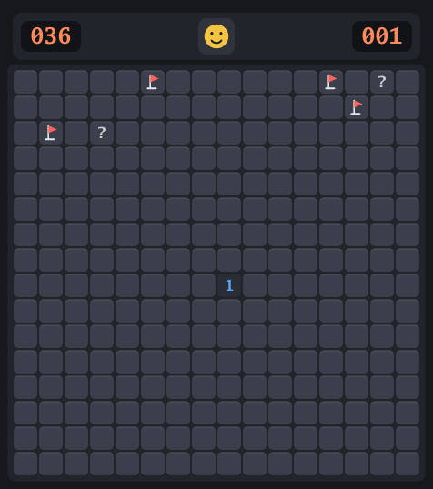
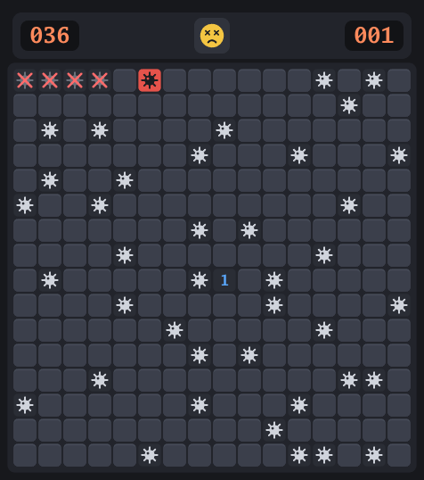
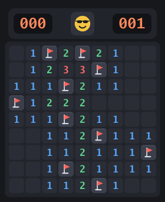

# mine

A minesweeper game for the desktop, written in Go with [Ebitengine](https://ebitengine.org/).

Classic rules and controls, with a clean, flat, dark-only look.
All graphics, including the app icon, are drawn in code; there are no image assets.

<p>
  
  
  
</p>

## Install

Requires Go 1.27+ and a C toolchain (Ebitengine uses cgo).

On Ubuntu, install the development libraries first:

```sh
sudo apt install gcc libc6-dev libgl1-mesa-dev libxcursor-dev libxi-dev \
  libxinerama-dev libxrandr-dev libxxf86vm-dev libasound2-dev pkg-config
```

Then:

```sh
go install github.com/TechieQuokka/minesweeper/cmd/mine@latest
```

Or from a clone:

```sh
go install ./cmd/mine
```

To show the game in your Linux app menu, export the icon and add a desktop entry:

```sh
go run ./tools/mkicon -out assets
for s in 16 32 48 64 128 256 512; do
  install -Dm644 assets/icon-$s.png ~/.local/share/icons/hicolor/${s}x${s}/apps/mine-minesweeper.png
done
cat > ~/.local/share/applications/mine-minesweeper.desktop <<EOF
[Desktop Entry]
Type=Application
Name=Mine
Exec=$(go env GOPATH)/bin/mine
Icon=mine-minesweeper
StartupWMClass=mine-minesweeper
Terminal=false
Categories=Game;LogicGame;
EOF
```

## Usage

```
mine                 start a medium game (default)
mine easy            9x9,   10 mines
mine medium          16x16, 40 mines
mine hard            30x16, 99 mines
mine help            show usage
mine --version, -V   show version
```

To change difficulty, quit and run `mine` again with another level.

When a round ends, a one-line result is printed to the terminal:

```
cleared hard in 142s
boom! hard, 87s
```

## Controls

| Input                          | Action                                                  |
|--------------------------------|---------------------------------------------------------|
| Left click                     | Open a cell (on release)                                |
| Right click                    | Cycle flag → `?` → blank                                |
| Left + right, or middle click  | Chord: open all neighbors of a number whose flags match |
| `F2` or the face button        | Restart                                                 |

## Rules

- The first cell you open is never a mine (its neighbors may be).
- Opening a cell with no adjacent mines opens its neighbors automatically.
- The counter on the left shows mines minus flags; it can go negative.
- The timer starts at the first click and stops at 999.
- Win by opening every cell that is not a mine.

## Development

```sh
go test ./...
```

The game logic in `internal/game` has no rendering dependencies and is
fully unit-tested. To render snapshot PNGs of several game states for
visual review (opens a window briefly):

```sh
MINE_SNAPSHOT_DIR=/path/to/output go test ./internal/ui -run Snapshots
```

Project layout:

```
cmd/mine/        CLI entry point
internal/game/   game rules (pure Go)
internal/ui/     Ebitengine rendering and input
tools/mkicon/    exports the app icon as PNG files
SPEC.md          detailed behavior specification
```

The version string can be set at build time:

```sh
go build -ldflags "-X main.version=v1.2.3" ./cmd/mine
```
